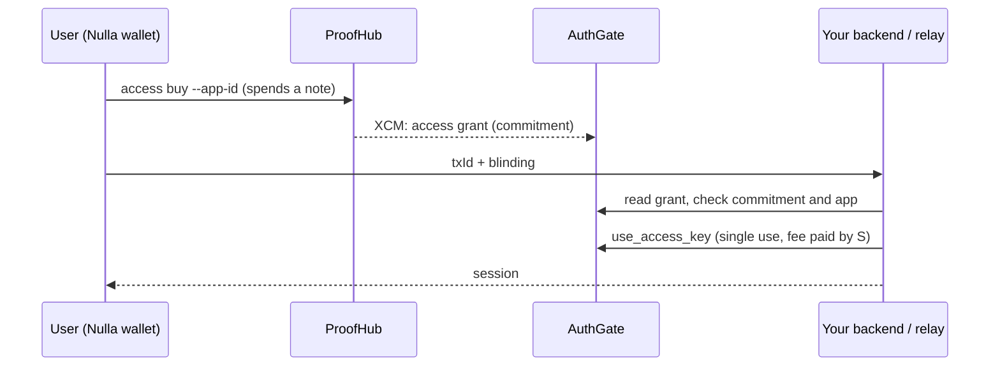

# @nulla/authgate-sdk

Accept anonymous payments in a Web2 app with Nulla AuthGate. A user pays with a shielded note using the Nulla wallet and receives an access key (`txId` + `blinding`). Your server verifies and consumes the key on-chain and opens a session. You never learn who the user is.



## 1. Get an app slot

Apps are registered by the Nulla team. Submit the provider form (`/apply` on the Nulla provider portal) with your service name, `appId`, price in NULLA and payment address. After approval you receive your `appId`; users buy keys for it with:

```bash
nulla-wallet access buy --app-id <appId-as-64-hex> --note-id 0
```

## 2. Install

```bash
npm install @nulla/authgate-sdk   # Node >= 18
```

Defaults point to Nulla mainnet (`DEFAULT_ENDPOINTS`). Override with `authgateRpc` if needed.

## 3. Integrate

Create a dedicated AuthGate account to pay fees (`use_access_key` costs a small fee). Keep its balance low and its mnemonic in an environment variable.

### Mode A: you have a backend

```js
const { NullaAuthGate } = require('@nulla/authgate-sdk');

const ag = new NullaAuthGate();
await ag.connect();

app.post('/auth/nulla', async (req, res) => {
  const { txId, blinding } = req.body;
  const r = await ag.verifyAndConsume(txId, blinding, process.env.BACKEND_MNEMONIC, {
    expectedAppId: process.env.APP_ID,          // required
  });
  if (!r.ok) return res.status(403).json({ error: r.reason });
  res.json({ token: issueYourSession(r.appId) });
});
```

`expectedAppId` is mandatory: without it a key bought for another app would be accepted. Full example: [example/server.js](example/server.js).

### Mode B: frontend only (relay)

Run a relay you control. It holds the fee account and answers with a signed session token.

```bash
RELAY_MNEMONIC="..." ALLOWED_APP_IDS="my-app-id" \
SESSION_SECRET="$(openssl rand -hex 32)" ALLOWED_ORIGINS="https://my-site.example" \
node example/relay.js
```

Browser:

```js
import { NullaAuthGateClient } from '@nulla/authgate-sdk/browser';

const client = new NullaAuthGateClient({ relayUrl: 'https://relay.my-site.example' });
await client.connect();
const r = await client.consumeViaRelay(txId, blinding, { expectedAppId: 'my-app-id' });
if (r.ok) sessionStorage.setItem('nullaToken', r.token);
```

Your backend must check the token on every protected request:

```js
const { verifySessionToken } = require('@nulla/authgate-sdk');
const session = verifySessionToken(token, process.env.SESSION_SECRET, { expectedAppId: 'my-app-id' });
if (!session) return res.status(401).end();
```

Serve the relay over HTTPS (reverse proxy) and set `TRUST_PROXY=1` only when it sits behind one. A complete, runnable login UI that uses this relay is the `authgate-demo-app` shipped next to this package; keep the "Powered by Nulla" badge visible in your own UI.

## API

| Export | Purpose |
| --- | --- |
| `new NullaAuthGate({ authgateRpc?, proofhubRpc? })` | Node client. `connect()`, `disconnect()` |
| `verifyKey(txId, blinding, { expectedAppId? })` | Read-only check. Returns `{ ok, appId?, reason? }` |
| `verifyAndConsume(txId, blinding, mnemonic, { expectedAppId })` | Verify then submit `use_access_key`. Returns `{ ok, appId, blockHash }` |
| `ag.admin.listApps()`, `getApp(appId)` | Read registered apps |
| `new NullaRelay({ relayMnemonic, allowedAppIds, sessionSecret, allowedOrigins?, port?, sessionTtlSec?, rateLimit?, trustProxy? })` | HTTP relay: `POST /consume`, `GET /health`. `start()`, `stop()` |
| `signSessionToken`, `verifySessionToken` | HMAC session tokens issued by the relay |
| `NullaAuthGateClient` (`/browser`) | `verifyOnly`, `consumeViaRelay`, `getStats` |
| `accessKeyCommitment`, `normaliseAppId`, `nullaToPlanck` | Helpers |

`ag.admin.registerApp / updateApp` require sudo and are used by the Nulla team only.

### Rejection reasons

`txId must be 16 bytes`, `blinding must be 32 bytes`, `Access grant not found` (wrong txId or the XCM message has not arrived yet; retry after a few blocks), `Access key already used`, `Blinding does not match stored commitment`, `Access key is for a different app`. On-chain failures surface as `accessKeys.<Error>`.

## Security notes

- `blinding` is a secret. Send it only over HTTPS and never log it.
- Each key works once; consumption is enforced on-chain.
- The address that signs `use_access_key` is public. Use a dedicated account, not one that holds funds you care about.
- The relay only consumes keys for `allowedAppIds`, limits body size and request rate, and allows browser calls only from `allowedOrigins`.
- Keep `SESSION_SECRET` and mnemonics out of source control.

## Go-live checklist

1. Provider request approved and `appId` received.
2. Fee account funded on AuthGate; mnemonic in an environment variable.
3. `expectedAppId` / `allowedAppIds` set to your appId.
4. HTTPS in front of your backend or relay; `allowedOrigins` limited to your site.
5. Test with a real key: `access buy`, then submit once (success) and twice (`Access key already used`).

## Documentation

- [How it works](docs/HOW_IT_WORKS.md): architecture, privacy model, threat model
- [Integration guide](docs/INTEGRATION.md): backend, relay and frontend integration, going live
- [API reference](docs/API.md)
- [Provider onboarding](docs/PROVIDER_ONBOARDING.md): request form, review and on-chain registration

## Team tools

The Nulla team runs a provider request form, a review page and `register-approved.js` (registers approved apps with sudo keys on a trusted machine). They live in `portal/` of the source repository and are not part of the npm package.

## Development

```bash
npm test          # unit tests
npm run smoke     # read-only check against Nulla mainnet
```

License: Apache-2.0
