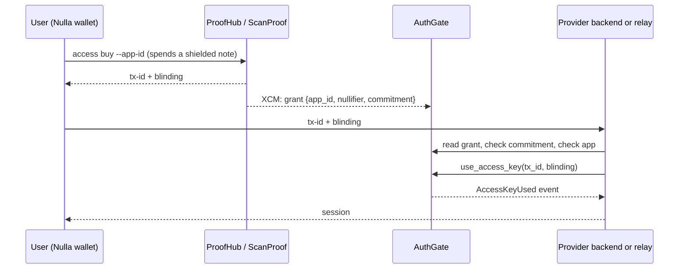

# How AuthGate works

AuthGate lets a Web2 service sell access without ever learning who the buyer is. The buyer pays with a shielded note, receives a one-time access key, and presents it to the service. The service verifies and consumes the key on-chain.

## Components

| Component | Role |
| --- | --- |
| **Nulla wallet** (CLI, desktop, Android) | Spends a shielded note or coin and returns `tx-id` + `blinding` to the user |
| **ProofHub** (para 2000) | Verifies the STARK proof of the spend (quantum lane), pays the app's payment address, sends the grant to AuthGate via XCM |
| **ScanProof** (para 2002) | Same role for the homomorphic (Pedersen coin) lane |
| **AuthGate** (para 2003) | Stores app slots and access grants; verifies and consumes keys (`access-keys` pallet) |
| **Provider backend or relay** | Your server. Checks the key, consumes it, opens your own session |
| **This SDK** | Does the checking and consuming for you, and issues signed session tokens |

## End-to-end flow

1. **Purchase.** The wallet spends a note or coin worth the app's price. The proof shows the spend is valid without revealing which note was spent or who owns it. The payment goes to the app's registered payment address.
2. **Grant.** ProofHub sends AuthGate an XCM message that creates `AccessGrants[tx_id]`:

   | Field | Meaning |
   | --- | --- |
   | `app_id` | The app this key is for (32 bytes) |
   | `nullifier` | Proves the note was spent exactly once |
   | `access_key_commitment` | `BLAKE3("nulla_access_key_v1" ‖ app_id ‖ blinding)` |
   | `used` | Whether the key was consumed |

   The wallet returns two values to the user: `tx-id` (16 bytes, hex) and `blinding` (32 bytes, hex). The blinding is never sent on-chain at purchase time; only its commitment is.
3. **Presentation.** The user gives `tx-id` and `blinding` to the provider (paste into a form).
4. **Verification.** The provider reads the grant from AuthGate and checks that it exists, is unused, belongs to the provider's app, and that the commitment matches the blinding. The SDK does this locally before spending any fee.
5. **Consumption.** The provider submits `use_access_key(tx_id, blinding)`. The pallet recomputes the commitment, marks the grant `used`, and emits `AccessKeyUsed`. The key can never work again.
6. **Session.** The provider opens its own session (cookie, JWT, or the relay's signed token).

## What each party learns

| Party | Learns | Does not learn |
| --- | --- | --- |
| Provider | That someone holding a valid key for its app showed up, when, and their network address (IP) | Who paid, which wallet, which note |
| Chain observers | That a key for app X was bought and later consumed | Who bought it; the buyer and the consumer are not linked on-chain, because the consume transaction is signed by the provider's fee account |
| Nulla team | App registry and payment totals per app | Individual buyers |

The consume transaction is signed, so its signer is public. In this SDK the signer is the provider's fee account, never the user. (The wallet also has `access use`, which lets a user consume a key themselves. That reveals the user's address on AuthGate, so use a throwaway wallet if you do it.)

Network-level privacy (IP address) is outside AuthGate. Users who need it should connect through a VPN or Tor.

## Security properties

- **Single use.** Enforced by the pallet (`KeyAlreadyUsed`). Replaying a key always fails.
- **Bearer secret.** Whoever knows `tx-id` and `blinding` can consume the key. Treat the blinding like a password: HTTPS only, never log it. After consumption it is public on-chain and worthless.
- **App binding.** A key is bound to one `app_id`. The SDK requires you to state which app(s) you serve (`expectedAppId`, `allowedAppIds`) and refuses keys for other apps before sending any transaction. Without this check, a key bought for a cheap app could unlock an expensive one.
- **Relay protections.** The relay only consumes keys for its allowed apps, limits body size and request rate, answers browser calls only from allowed origins, and never returns internal error text.
- **Signed sessions.** The relay returns an HMAC-SHA256 token with an expiry. Your backend verifies it with `verifySessionToken`. Tokens cannot be forged without `SESSION_SECRET`.

## Known limitations

- **Consumed but not delivered.** If the key is consumed on-chain but the HTTP response is lost, the key cannot be re-issued. Users must buy a new one. Providers that need retries should persist `tx-id -> session` on their side.
- **Fees.** Consuming a key costs a small fee paid by the provider's fee account (about 0.0016 NULLA at the time of writing). Keep that account funded, with a limited balance.
- **Exact price.** The note or coin spent must be worth exactly the app's price when the purchase has no change output; otherwise the wallet reports a proof error.
- **Sessions are yours.** AuthGate proves payment. How long access lasts, and what it unlocks, is defined by your application.
- **Third-party CDN.** The browser client loads its libraries from `esm.sh` (pinned versions). For production, bundle them with your own build.
